<!--
  This profile is generated. Edit generator/src/content.mjs, then run
  `npm ci && npm run build` inside generator/ and commit assets/.
  The signal card is redrawn by .github/workflows/profile.yml every 12 hours.
-->

  

  
  
  

